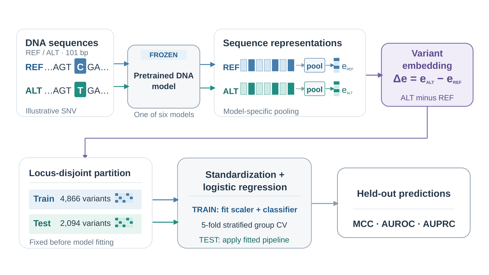

# Genomic foundation models and complementary variant scoring in LGMD-associated genes

[](https://doi.org/10.5281/zenodo.24028595)
[](https://github.com/sarvezh1/lgmd-genomic-foundation-models/releases/tag/v1.0.0)
[](LICENSE)
[](requirements.txt)

This repository accompanies **Genomic foundation models and complementary
variant-scoring strategies in LGMD-associated genes: architecture, adaptation,
and sequence context**. It provides the canonical benchmark, variant-level
predictions, final figures and tables, and portable code needed to reproduce
the reported numerical analyses.

## Research overview

The benchmark contains 6,960 GRCh38 single-nucleotide variants from ten
LGMD-associated genes: *ANO5, CAPN3, DNAJB6, DYSF, FKRP, LMNA, SGCA, SGCB,
SGCG,* and *TCAP*. Aggregate ClinVar classifications were mapped to a binary
pathogenic/likely pathogenic versus benign/likely benign outcome. These labels
are ClinVar assertions in LGMD-associated genes; they are not uniformly
phenotype-specific LGMD diagnoses.

The fixed split contains 4,866 training and 2,094 test variants. Exact
chromosome-position loci are disjoint between partitions. The test set contains
509 positive and 1,585 negative variants.

## Models and experiments

Six genomic foundation-model architectures were evaluated: DNABERT-2,
Nucleotide Transformer V2, HyenaDNA, Caduceus-Ph, modernGENA, and Evo2.
Experiments included frozen 101-bp representations with logistic-regression
readouts, supervised 101-bp adaptation, and frozen 201- and 501-bp context
experiments. Five architectures used full fine-tuning; Evo2 used LoRA.

Two native variant scores were primary comparators: GPN-Star V100 and
AlphaGenome AVI. GPN-Star M447 and P243 were sensitivity configurations.
Native scores were not trained under the sequence-model protocol and are
reported as complementary scoring strategies rather than controlled
architecture comparisons.



**Figure 1. Frozen reference–alternate embedding workflow.** Reference and
alternate sequences are processed independently by a frozen genomic foundation
model, pooled into sequence representations, and differenced as alternate minus
reference before logistic-regression classification and held-out evaluation.
A [vector PDF](figures/figure1.pdf) is also provided.

## Key findings

- Longer context produced the largest gain for Evo2: frozen 101 bp reached MCC
  0.644, AUROC 0.879, and AUPRC 0.818; frozen 501 bp reached MCC 0.864,
  AUROC 0.964, and AUPRC 0.952.
- GPN-Star V100 and AlphaGenome AVI achieved the strongest fixed-test
  discrimination, while using information sources distinct from local
  sequence-model representations.
- Five variants were misclassified by all twelve original 101-bp sequence
  configurations, two by all 24 sequence configurations, and one by all 26
  primary configurations.
- The shared-error and "correct by any additional strategy" analyses are
  retrospective overlap analyses, not results from a trained ensemble.

The finalized frozen embedding workflow (Figure 1) and approved result Figures 2-5 are in
[figures](figures/), with machine-readable plotting data for Figures 2-5. Publication-formatted
Tables 1-4 and
full-precision reference tables are in [tables](tables/).

## Repository structure

| Path | Contents |
| --- | --- |
| `data/` | Canonical variants, configuration registries, fixed-test predictions, gene-held-out predictions, and intervals |
| `scripts/methods/` | ClinVar preprocessing, sequence extraction, canonical split generation, and locus bootstrap |
| `scripts/reproduction/` | Fixed-test metrics and manuscript table/figure-data reproduction |
| `scripts/validation/` | Scientific data and repository validators |
| `figures/` | Frozen embedding workflow Figure 1; approved result Figures 2-5 in PNG/PDF with plotting data |
| `tables/` | Approved publication tables, full-precision references, and the 28-configuration supplement |
| `metadata/` | Model/adaptation metadata, evidence hashes, asset checksums, and 452 source-to-result links |
| `tests/` | Scientific regression tests |

Detailed scientific procedures are in [METHODS.md](METHODS.md). Installation,
commands, and reproducibility boundaries are in
[REPRODUCIBILITY.md](REPRODUCIBILITY.md).

## Reproduce the analyses

Python 3.10 or newer is recommended.

```bash
python -m pip install -r requirements.txt
python scripts/reproduction/reproduce_metrics.py
python scripts/methods/gene_heldout_bootstrap.py
python scripts/reproduction/reproduce_manuscript.py
python scripts/validation/validate_repository.py
python -m unittest discover -s tests -p "test_*.py"
```

Generated files are written under `verification_outputs/`; distributed
evidence and approved assets are not overwritten.

## Data and model availability

The repository distributes the complete canonical benchmark and normalized
variant-level predictions needed for the published analyses. It does not
distribute raw ClinVar downloads, the GRCh38 FASTA, model weights, tokenizers,
embeddings, or adapted checkpoints. External resources must be obtained from
their providers under their applicable terms. See
[THIRD_PARTY_NOTICES.md](THIRD_PARTY_NOTICES.md).

## Scientific limitations

The canonical split is exact-locus-disjoint but not region-disjoint; the median
test-to-training locus distance is 3 bp. Labels and review status are
heterogeneous, model families do not share identical upstream information,
and no independent external cohort was evaluated. Gene-held-out analyses are
reported separately and do not establish unseen-region or clinical
generalization. Original model-training and inference runs cannot all be
regenerated from the distributed files.


## Citation, authors, and license

If you use the benchmark data, model predictions, or analysis code,
please cite the archived v1.0.0 release:

> Galgale, S., Vats, I., Wilson, J., & Haldar, A. (2026).
> *Genomic foundation models and complementary variant-scoring
> strategies in LGMD-associated genes: architecture, adaptation,
> and sequence context* (Version 1.0.0) [Computer software].
> Zenodo. https://doi.org/10.5281/zenodo.24028595

Machine-readable citation metadata is available in
[CITATION.cff](CITATION.cff).

Please also cite the accompanying research manuscript once published.

Original repository code is released under the
[MIT License](LICENSE). Third-party datasets, model resources, and
provider-derived outputs remain subject to their respective terms,
as described in [THIRD_PARTY_NOTICES.md](THIRD_PARTY_NOTICES.md).